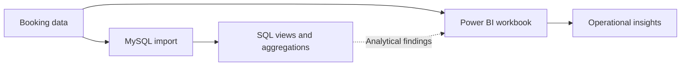
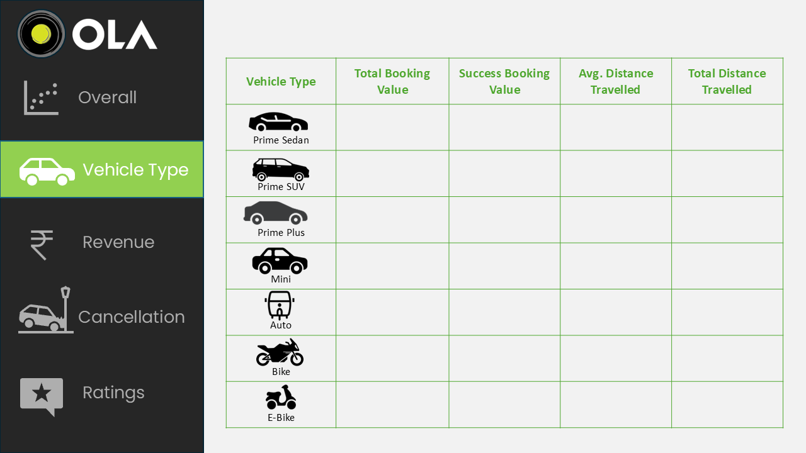
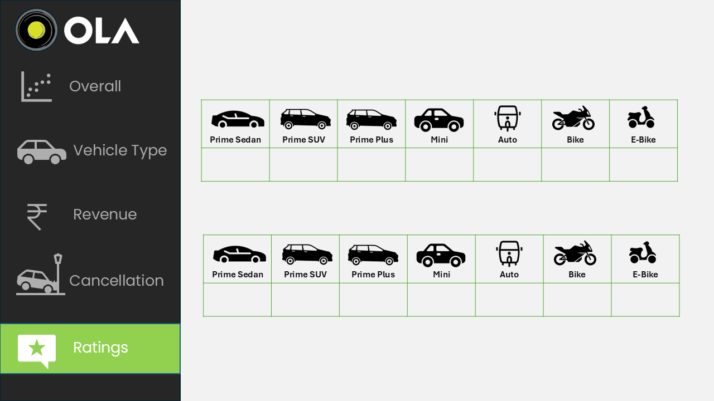

# Ola Ride Cancellation & Booking Analytics

  

A business intelligence portfolio project that uses SQL and Power BI to explore ride booking outcomes, cancellation reasons, customer activity and operational performance.

## Business problem

Ride cancellations and incomplete trips can affect service reliability. This project examines booking records to distinguish customer and driver cancellations, understand incomplete rides and identify areas for further operational investigation.

## Dataset

The repository contains [Bookings.csv](Bookings.csv) and [Bookings.xlsx](Bookings.xlsx). The SQL analysis uses booking and customer IDs, booking status, vehicle type, ride distance, cancellation and incomplete-ride reasons, ratings, payment method and booking value. The original dataset provenance and sampling methodology are not documented here; results should be interpreted within the supplied dataset rather than as verified company-wide statistics.

## Workflow



## SQL analysis

[Queries.sql](Queries.sql) defines ten views addressing the following questions:

| Analysis | SQL technique |
|---|---|
| Successful bookings | WHERE filter |
| Average distance by vehicle type | AVG, GROUP BY |
| Customer cancellations | COUNT, WHERE |
| Five most active customers | COUNT, GROUP BY, ORDER BY, LIMIT |
| Driver cancellations for personal/car issues | COUNT, WHERE |
| Prime Sedan driver rating range | MIN, MAX |
| UPI payments | WHERE filter |
| Average customer rating by vehicle type | AVG, GROUP BY |
| Successful booking value | SUM, WHERE |
| Incomplete rides and reasons | Column selection, WHERE |

Example from the SQL workflow:

```sql
SELECT Vehicle_Type, AVG(Ride_Distance) AS avg_distance
FROM bookings
GROUP BY Vehicle_Type;
```

## Dashboard and presentation

Open the [Power BI report](OLA%20Project%20BI.pbix) or browse the [project presentation](Ola-Slidesuhub.pptx) and [PDF report](OLA-Data-Analyst-Project-1.pdf).


<details>
<summary>Additional presentation slides</summary>






</details>

## Business interpretation

The analysis provides a framework for monitoring booking outcomes, identifying reported cancellation reasons and comparing vehicle-level metrics. Potential next steps include investigating pickup delays, evaluating driver-side issues and testing targeted interventions.

A reduction in cancellation rate would require a measured before-and-after comparison or controlled experiment. This repository demonstrates exploratory analysis and reporting, not a verified production intervention or realized reduction in cancellations.

## Repository contents

| File | Description |
|---|---|
| `Bookings.csv`, `Bookings.xlsx` | Booking data |
| `Queries.sql` | MySQL queries and views |
| `OLA Project BI.pbix` | Power BI report |
| `OLA-Data-Analyst-Project-1.pdf` | Project report |
| `Ola-Slidesuhub.pptx` | Presentation |
| `Ola-Slidesuhub/` | Presentation images |

## How to reproduce

```bash
git clone https://github.com/kartavyabh24/Ola-Identified-the-reason-trend-for-ride-cancellation.git
cd Ola-Identified-the-reason-trend-for-ride-cancellation
```

1. Use MySQL or MySQL Workbench. Create the `Ola` database and import `Bookings.csv` into a table named `bookings`, with column names matching the SQL script.
2. Run the view definitions and SELECT statements in `Queries.sql`, skipping `CREATE DATABASE Ola` if the database already exists. The script does not include a table creation or import routine. Use consistent table-name casing on case-sensitive systems.
3. Open `OLA Project BI.pbix` in Power BI Desktop on Windows. Update any source paths or credentials if prompted, then refresh the report.

## Skills demonstrated

SQL aggregation · Reusable views · KPI analysis · Power BI · Operational analytics · Business intelligence · Data storytelling

## Author

**Kartavya Bhardwaj** — M.S. Data Science, Saint Peter's University  
[LinkedIn](https://www.linkedin.com/in/kartavya24) | [GitHub](https://github.com/kartavyabh24)
