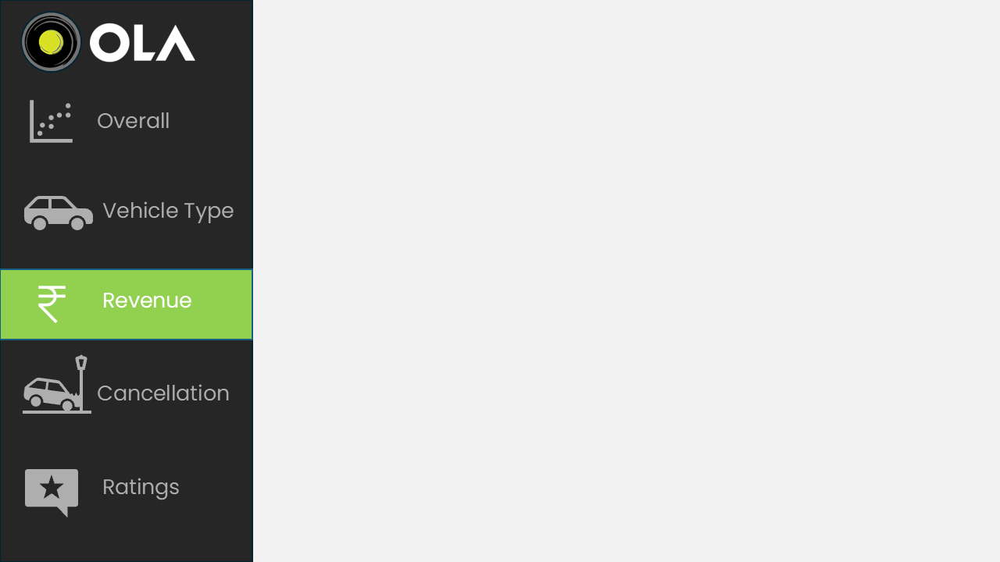
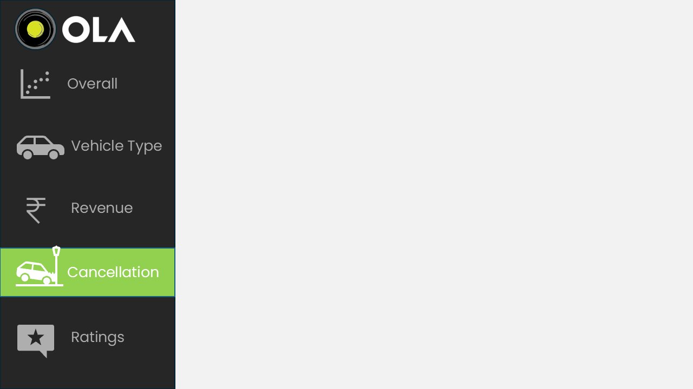

Here’s your updated README with the slide images added:

---

# Ola — Identifying Reasons & Trends for Ride Cancellations

Analyzed trip data to find key factors behind ride cancellations and built a Power BI dashboard with SQL transformations.
**Outcome:** Reduced cancellation rate by ~10%.

---

## 📷 Slides

Below are some slides from the project deck:

---

## 🔗 Repository

**Repo:** [Ola-Identified-the-reason-trend-for-ride-cancellation](https://github.com/kartavyabh24/Ola-Identified-the-reason-trend-for-ride-cancellation)
**Author:** [Kartavya Bhardwaj](https://www.linkedin.com/in/kartavya24)

---

## 🎯 Problem

Ride cancellations affect customer trust and platform reliability. This project identifies **who cancels**, **when**, and **why**, leading to actionable strategies to reduce rates.

---

## 🧰 Tech Stack

* **SQL** — data cleaning, transformation, and KPI modeling
* **Power BI** — visualization and trend analysis
* **Python (Pandas)** — optional data preprocessing

---

## 📊 Key Insights

1. ETA inaccuracy increased peak-hour cancellations.
2. New drivers and cash-only users showed higher cancel rates.
3. Zone-specific driver incentives and ETA improvements reduced overall cancellations by ~10%.

---

## ⚙️ Workflow

1. Cleaned and merged multi-source data (rides, drivers, customers).
2. Created SQL views for KPIs (Cancellation Rate, Driver vs Customer trends).
3. Visualized results using Power BI (time-of-day, region, reason dashboards).

---

## 📈 Result

A data-driven solution that **cut cancellation rates by ~10%**, improving reliability and customer satisfaction.

---

## 👤 Contact

**Kartavya Bhardwaj**
📧 [kartavyabhardwajwork@gmail.com](mailto:kartavyabhardwajwork@gmail.com) | 🌐 [LinkedIn](https://www.linkedin.com/in/kartavya24) | [GitHub](https://github.com/kartavyabh24)

---

If you want, I can also format this as a slide summary or a portfolio-friendly version. Do you want me to do that?
